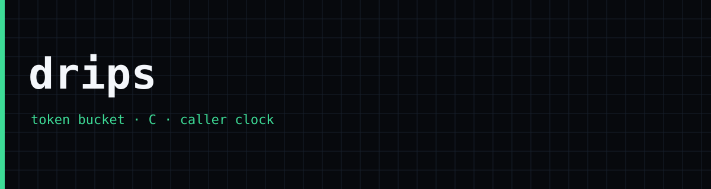

<p align="center"></p>

# drips

Token bucket in C. You pass the time. The bucket does not read a clock and does not allocate.

`drip_init` fills the bucket to `burst`. `drip_take` adds tokens for the elapsed nanoseconds, capped at `burst`, then subtracts `n`. If there are not enough tokens it returns `-1` and leaves them where they are.

```c
drip bucket;
drip_init(&bucket, 10, 4, now_ns);   /* 10 tokens/sec, burst 4 */
if (drip_take(&bucket, now_ns, 1) != 0) {
    /* refuse the call */
}
```

A clock that jumps backwards does not mint tokens. `n == 0` only refills. A take larger than `burst` never succeeds.

```
make test
```

MIT.
